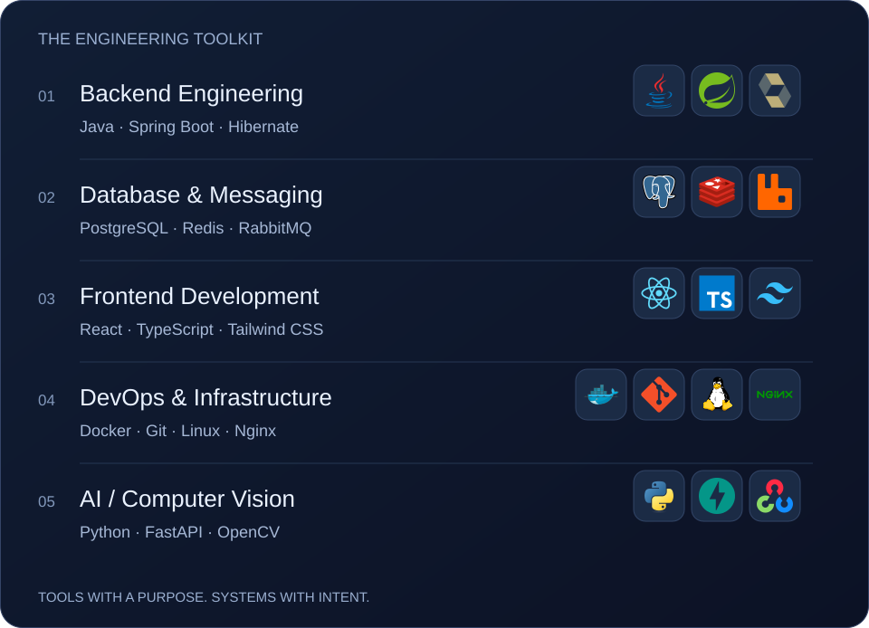

<!-- Personal portfolio. SVG artwork lives in assets/. -->

  

  <a href="https://github.com/RahimovShaxriyor?tab=repositories"><b>Explore my work ↗</b></a> &nbsp; · &nbsp;
  <a href="https://t.me/raximovshaxriyor"><b>Telegram</b></a> &nbsp; · &nbsp;
  <a href="mailto:rahimov55shah@gmail.com"><b>Get in touch</b></a>

### Behind the systems

I’m **Shaxriyor**, a software engineer working with **Java and Spring Boot**. I build APIs, connect services, and work through the details that make systems reliable: authentication, relational data, asynchronous events, and containerized infrastructure.

With **React and TypeScript**, I bring that work into usable interfaces. My projects connect backend engineering with the experience on the other side of the API.

 

## Selected work

Hotel operations across **reception, housekeeping, room service, and maintenance**.

**Inside the architecture** · PostgreSQL row locking for room allocation, a transactional outbox with RabbitMQ, and WebSocket updates for the operations dashboard.

[**Explore HotelOS ↗**](https://github.com/RahimovShaxriyor/hotelos-microservices) &nbsp; · &nbsp; [Architecture](https://github.com/RahimovShaxriyor/hotelos-microservices#architecture)

 

A wholesale management demo for **products, inventory, customers, orders, and payments**.

**Inside the architecture** · Domain-specific Spring services behind Nginx, a React interface, and Docker Compose networking with PostgreSQL persistence.

[**Explore CloudWare Pro ↗**](https://github.com/RahimovShaxriyor/cloudeware-pro) &nbsp; · &nbsp; [Service topology](https://github.com/RahimovShaxriyor/cloudeware-pro/blob/main/docker-compose.yml)

 

An interactive learning project that makes **Redis behavior visible in the browser**.

**Inside the architecture** · Expiring keys, atomic counters, and courier status stored in Redis hashes through a Spring service layer.

[**Explore Redis Visual Demo ↗**](https://github.com/RahimovShaxriyor/ExampleWeb-Redis)

 

## Engineering toolkit

<picture>
  <source media="(max-width: 640px)" srcset="assets/sr-toolkit-mobile.svg">
  
</picture>

<b>Technologies &amp; working areas</b>

- **Backend Engineering:** Java, Spring Boot, Spring Security, Hibernate, REST APIs.
- **Database &amp; Messaging:** PostgreSQL, Redis, RabbitMQ.
- **Frontend Development:** React, TypeScript, Vite, Tailwind CSS.
- **DevOps &amp; Infrastructure:** Docker, Git, Linux, Nginx, GitHub Actions / CI/CD.
- **AI / Computer Vision:** Python, FastAPI, MediaPipe, OpenCV.
- **Also working with:** Telegram Mini Apps.

 

## Currently building

**BTS · Full-Stack Software Engineer**  
February 2026 — Present

Java &amp; Spring Boot · React &amp; TypeScript · PostgreSQL · Docker

[Browse all repositories ↗](https://github.com/RahimovShaxriyor?tab=repositories) &nbsp; · &nbsp; [Contribution history](https://github.com/RahimovShaxriyor?tab=overview)

 

---

### Let’s connect.

For project inquiries and engineering conversations.

[**Email ↗**](mailto:rahimov55shah@gmail.com) &nbsp; · &nbsp; [**Telegram ↗**](https://t.me/raximovshaxriyor) &nbsp; · &nbsp; [**GitHub ↗**](https://github.com/RahimovShaxriyor)

Shaxriyor Rakhimov · APIs, events, and the systems that connect them.
