<h1 align="center">Shaxriyor Rakhimov</h1>

  <strong>Software Engineer · Java &amp; Spring Boot · Backend Systems</strong> 
  APIs, data, and the systems that connect them.

  <a href="https://github.com/RahimovShaxriyor">GitHub</a> &nbsp; / &nbsp;
  <a href="https://t.me/raximovshaxriyor">Telegram</a> &nbsp; / &nbsp;
  <a href="mailto:rahimov55shah@gmail.com">Email</a>

<picture>
  <source media="(prefers-color-scheme: dark)" srcset="assets/request-flow-dark.svg">
  <source media="(prefers-color-scheme: light)" srcset="assets/request-flow-light.svg">
  
</picture>

## About

I build backend applications with **Java and Spring Boot**, working across REST APIs, authentication, relational data, and containerized infrastructure. My projects explore service boundaries, asynchronous messaging, and data consistency.

With **React and TypeScript**, I also connect backend capabilities to usable interfaces — from API design to the application people interact with.

## Featured Projects

<table width="100%">
<tr><td>
01 / EVENT-DRIVEN BACKEND
<h3><a href="https://github.com/RahimovShaxriyor/hotelos-microservices">HotelOS</a></h3>

Hotel operations across reception, housekeeping, room service, and maintenance.

<strong>Engineering focus:</strong> PostgreSQL row locking for room allocation, transactional outbox events over RabbitMQ, and WebSocket updates for the operations dashboard.

<code>Java</code> <code>Spring Boot</code> <code>PostgreSQL</code> <code>RabbitMQ</code> <code>Docker</code>

<a href="https://github.com/RahimovShaxriyor/hotelos-microservices#architecture">Explore architecture →</a>

</td></tr>
<tr><td>
02 / FULL-STACK BUSINESS APPLICATION
<h3><a href="https://github.com/RahimovShaxriyor/cloudeware-pro">CloudWare Pro</a></h3>

A wholesale management demo covering products, inventory, customers, orders, and payments.

<strong>Engineering focus:</strong> domain-specific backend services behind Nginx, a React interface, and Docker Compose networking with PostgreSQL persistence.

<code>Spring Boot</code> <code>React</code> <code>TypeScript</code> <code>PostgreSQL</code> <code>Nginx</code>

<a href="https://github.com/RahimovShaxriyor/cloudeware-pro/blob/main/docker-compose.yml">Explore service topology →</a>

</td></tr>
<tr><td>
03 / DATA &amp; CACHING LAB
<h3><a href="https://github.com/RahimovShaxriyor/ExampleWeb-Redis">Redis Visual Demo</a></h3>

An interactive learning project that makes Redis behavior visible in the browser.

<strong>Engineering focus:</strong> expiring keys, atomic counters, and courier status stored in Redis hashes through a Spring service layer.

<code>Java</code> <code>Spring Boot</code> <code>Spring Data Redis</code> <code>Docker Compose</code>

<a href="https://github.com/RahimovShaxriyor/ExampleWeb-Redis">Explore the implementation →</a>

</td></tr>
</table>

[All public repositories →](https://github.com/RahimovShaxriyor?tab=repositories)

## Tech Stack

 **Core Backend**  
Java · Spring Boot · Spring Security · Hibernate · REST APIs

 **Databases & Messaging**  
PostgreSQL · Redis · RabbitMQ

 **Frontend**  
React · TypeScript · Vite · Tailwind CSS

 **Infrastructure & Tools**  
Docker · Git · Linux · Nginx · GitHub Actions / CI/CD

**Also working with:** Python, FastAPI, MediaPipe, OpenCV, and Telegram Mini Apps.

## Experience

**BTS — Full-Stack Software Engineer**  
February 2026 — Present  
Java · Spring Boot · React · TypeScript · PostgreSQL · Docker

## GitHub Activity

<a href="https://github.com/RahimovShaxriyor?tab=overview">
  <picture>
    <source media="(prefers-color-scheme: dark)" srcset="https://github-profile-summary-cards.vercel.app/api/cards/profile-details?username=RahimovShaxriyor&amp;theme=github_dark">
    <source media="(prefers-color-scheme: light)" srcset="https://github-profile-summary-cards.vercel.app/api/cards/profile-details?username=RahimovShaxriyor&amp;theme=github">
    
  </picture>
</a>

[View contribution history on GitHub →](https://github.com/RahimovShaxriyor?tab=overview)

## Get in Touch

For project inquiries and engineering conversations:

[rahimov55shah@gmail.com](mailto:rahimov55shah@gmail.com) · [@raximovshaxriyor on Telegram](https://t.me/raximovshaxriyor) · [@RahimovShaxriyor on GitHub](https://github.com/RahimovShaxriyor)
