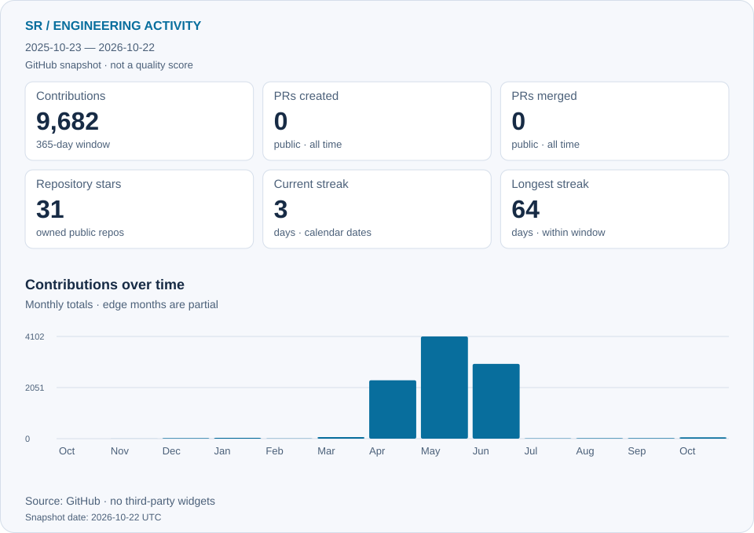

<!-- Personal portfolio. SVG artwork lives in assets/. -->

  <picture>
  <source media="(max-width: 640px)" srcset="assets/sr-hero-mobile.svg">
  
</picture>

  <a href="https://github.com/RahimovShaxriyor?tab=repositories"><b>Explore my work ↗</b></a> &nbsp; · &nbsp;
  <a href="https://t.me/raximovshaxriyor"><b>Telegram</b></a> &nbsp; · &nbsp;
  <a href="mailto:rahimov55shah@gmail.com"><b>Get in touch</b></a>

## About me

I’m **Shaxriyor**, a software engineer working with **Java and Spring Boot**. I build APIs, connect services, and work through the details that make systems reliable: authentication, relational data, asynchronous events, and containerized infrastructure.

With **React and TypeScript**, I bring that work into usable interfaces. My projects connect backend engineering with the experience on the other side of the API.

 

## Selected work

<a href="https://github.com/RahimovShaxriyor/cloudeware-pro">
  <picture>
  <source media="(max-width: 640px)" srcset="assets/cloudware-cover-mobile.svg">
  
</picture>
</a>

**Java 17 · Spring Boot · Spring JDBC · React / TypeScript · PostgreSQL · Nginx**

A full-stack demonstration application connecting products, inventory, customer orders, and payments through a React interface and Docker Compose environment.

[**Explore CloudWare Pro ↗**](https://github.com/RahimovShaxriyor/cloudeware-pro) &nbsp; · &nbsp; [Architecture](https://github.com/RahimovShaxriyor/cloudeware-pro/blob/main/docs/ARCHITECTURE.md) &nbsp; · &nbsp; [Setup guide](https://github.com/RahimovShaxriyor/cloudeware-pro/blob/main/README.md)

 

<a href="https://github.com/RahimovShaxriyor/ExampleWeb-Redis">
  <picture>
  <source media="(max-width: 640px)" srcset="assets/redis-cover-mobile.svg">
  
</picture>
</a>

**Java 17 · Spring Boot · Spring Data Redis · Redis 7 · Docker Compose**

An interactive learning lab for key expiry, atomic counters, and courier-state hashes, backed by Spring Data Redis.

[**Explore Redis Visual Demo ↗**](https://github.com/RahimovShaxriyor/ExampleWeb-Redis) &nbsp; · &nbsp; [Implementation](https://github.com/RahimovShaxriyor/ExampleWeb-Redis/blob/main/src/main/java/org/gatewayservice/RedisDemoService.java) &nbsp; · &nbsp; [Setup guide](https://github.com/RahimovShaxriyor/ExampleWeb-Redis/blob/main/README.md)

 

### CODECITY · Interactive portfolio

An interactive 3D city built from public GitHub repository data, with a searchable catalog and a lightweight rendering mode.

**React · TypeScript · Three.js · Vite**

[Repository & setup ↗](https://github.com/RahimovShaxriyor/codecity) · [Architecture](https://github.com/RahimovShaxriyor/codecity/blob/main/docs/ARCHITECTURE.md)

## GitHub activity

<picture>
  <source media="(max-width: 640px) and (prefers-color-scheme: dark)" srcset="assets/engineering/activity-dark-mobile.svg">
  <source media="(max-width: 640px)" srcset="assets/engineering/activity-light-mobile.svg">
  <source media="(prefers-color-scheme: dark)" srcset="assets/engineering/activity-dark.svg">
  
</picture>

[Contribution history](https://github.com/RahimovShaxriyor?tab=overview) · [Data sources & definitions](docs/activity.md)

## Engineering toolkit

<picture>
  <source media="(max-width: 640px)" srcset="assets/sr-toolkit-mobile.svg">
  
</picture>

<b>Technologies &amp; working areas</b>

- **Backend Engineering:** Java, Spring Boot, Spring Security, Hibernate, REST APIs.
- **Database &amp; Messaging:** PostgreSQL, Redis, RabbitMQ.
- **Frontend Development:** React, TypeScript, Vite, Tailwind CSS.
- **DevOps &amp; Infrastructure:** Docker, Git, Linux, Nginx.
- **AI / Computer Vision:** Python, FastAPI, MediaPipe, OpenCV.
- **Also working with:** Telegram Mini Apps.

 

## Experience

**BTS · Full-Stack Software Engineer**  
February 2026 — Present

Java &amp; Spring Boot · React &amp; TypeScript · PostgreSQL · Docker

[Browse all repositories ↗](https://github.com/RahimovShaxriyor?tab=repositories) &nbsp; · &nbsp; [Contribution history](https://github.com/RahimovShaxriyor?tab=overview)

 

---

### Let’s connect.

For project inquiries and engineering conversations.

[**Email ↗**](mailto:rahimov55shah@gmail.com) &nbsp; · &nbsp; [**Telegram ↗**](https://t.me/raximovshaxriyor) &nbsp; · &nbsp; [**GitHub ↗**](https://github.com/RahimovShaxriyor)

Shaxriyor Rakhimov · APIs, events, and the systems that connect them.

